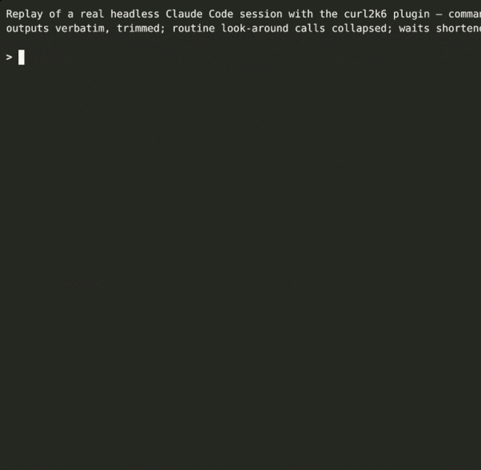
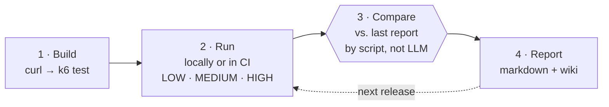
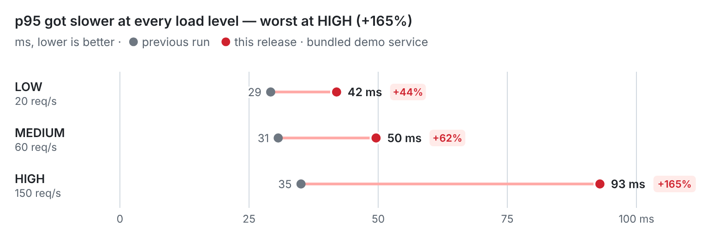

# curl2k6

[](https://github.com/talikbaku/curl2k6/actions/workflows/test.yml)
[](https://github.com/talikbaku/curl2k6/releases)
[](#-install)


**Paste a curl → get a k6 load test, a report, and a computed answer to "did this release get slower?"**

A Claude Code plugin for QA and performance engineers.



## 🤖 Don't want to read? Copy this into Claude Code

It checks the prerequisites, installs the plugin and sets it up:

```text
Set up curl2k6 for me (https://github.com/talikbaku/curl2k6) — a Claude Code plugin that turns a curl into a k6 load test, runs it, writes a report and checks for regressions against the previous run.
1. Check that k6 and Node.js >= 18 are installed; tell me how to install what's missing.
2. Install the plugin: /plugin marketplace add talikbaku/curl2k6 then /plugin install curl2k6@curl2k6
3. Run /curl2k6 init in my test repo and ask me the setup questions in one block.
4. Then I'll give you a curl.
Short docs: https://github.com/talikbaku/curl2k6/blob/main/llms.txt
```

## 🤔 Why not just ask Claude for a k6 script?

- **The verdict is computed.** `compare.mjs` applies fixed, unit-tested rules (p95 worse by >20%, success rate down by >1 pp), not an LLM's opinion.
- **No false alarms.** A different environment or load is reported as "not like-for-like", never as a regression.
- **Your stack.** Your CI, your Prometheus / Grafana / Datadog, reports as markdown in git. No Grafana Cloud needed.

**Works with:** curl · HAR · Postman · OpenAPI → local · Azure DevOps · GitLab / GitHub Actions / Jenkins (your pipeline) → Prometheus · Grafana · Datadog · Elasticsearch · InfluxDB → Markdown · Confluence · Azure DevOps Wiki



## 🚀 Install

```
/plugin marketplace add talikbaku/curl2k6
/plugin install curl2k6@curl2k6
```

Needs [k6](https://grafana.com/docs/k6/latest/set-up/install-k6/) and Node.js ≥ 18.

## ▶️ Use

```
/curl2k6 curl -H 'Authorization: Bearer <TOKEN>' https://api.stage.example.com/v2/items
```

1. **First time:** one block of questions, saved to `.curl2k6.yml`. Never asked again.
2. **Every run:** draft test → your OK → smoke → LOW / MEDIUM / HIGH → report.
3. **After a release:** *"re-run the load test, did it get slower?"* → comparison with the last report.

What it learns along the way (IP allowlists, caches, root causes) goes to `CURL2K6-FACTS.md`.

## 📊 What you get

<picture>
  <source media="(prefers-color-scheme: dark)" srcset="docs/media/p95-dark.png">
  
</picture>

<sub>Demo service with short custom profiles (20 / 60 / 150 req/s for 15 s), before and after a simulated bad release.</sub>

Full examples: [baseline report](examples/reports/items-api-2026-10-09-local-baseline.md) · [regression report](examples/reports/items-api-2026-10-09-local-regression.md)

## 🛡️ Safe by default

- **Secrets:** never written to tests, commits or reports. HAR / Postman imports swap them for env vars before Claude sees them.
- **Production:** every run needs your explicit OK, one profile at a time.

## 🧪 Try the demo (2 min)

Needs k6 and Node.js ≥ 18, or nothing at all in [](https://codespaces.new/talikbaku/curl2k6?quickstart=1)

```bash
git clone https://github.com/talikbaku/curl2k6.git && cd curl2k6 && bash examples/run-demo.sh
```


## 📚 More

**Status:** v1.3.2. Verified locally and on Azure DevOps; other CIs are driven through your existing pipeline. Submitted to the Claude Code plugin directory.

- [docs/MORE.md](docs/MORE.md): input formats, profiles, limits, CI gate without Claude, comparison with other tools
- [docs/GUIDE.md](docs/GUIDE.md): the full flow, step by step
- [CHANGELOG.md](CHANGELOG.md) · `npm test` for development

**Useful? ⭐ Star the repo** and tell us which CI template you want next in [Discussions](https://github.com/talikbaku/curl2k6/discussions).

[MIT](LICENSE) © 2026 Talat Gurbanbayov
